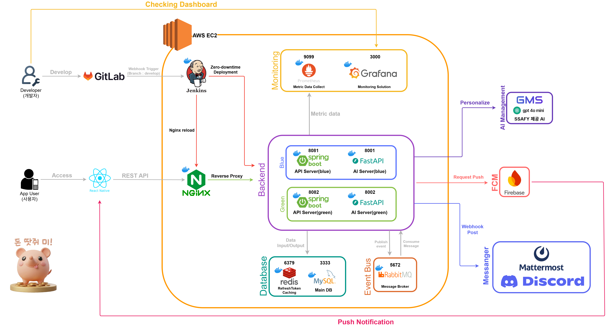

<!-- ============================================ -->
<!--        🐹 Donttaz — 돈땃쥐 README           -->
<!-- ============================================ -->

<!-- 🖼️ [TODO] 프로젝트 배너 이미지를 여기에 넣어주세요 -->
<p align="center">
  


<h1 align="center">🐹 Donttaz — 돈땃쥐</h1>

<p align="center">
  <b>월급 로그아웃을 막아주는 나만의 비밀 금고</b>
</p>

<p align="center">
  
  
  
  
  
  
  
  
  
  
  
  
  
  
</p>

---

## 📌 목차

1. [프로젝트 소개](#-프로젝트-소개)
2. [주요 기능](#-주요-기능)
3. [기술 스택](#-기술-스택)
4. [시스템 아키텍처](#-시스템-아키텍처)
5. [빠른 시작](#-빠른-시작)
6. [저장소 구조](#-저장소-구조)
7. [API 엔드포인트](#-api-엔드포인트)
8. [환경 변수](#-환경-변수)
9. [CI/CD 파이프라인](#-cicd-파이프라인)
10. [테스트](#-테스트)
11. [팀원 소개](#-팀원-소개)

---

## 🐹 프로젝트 소개

<!-- 🖼️ [TODO] 서비스 메인 소개 이미지 또는 GIF를 여기에 넣어주세요 -->
<!-- <p align="center">
  
</p> -->

**돈땃쥐(Donttaz)**는 2030 세대를 위한 **AI 기반 스마트 금고 핀테크 서비스**입니다.

단순히 돈을 "아끼게" 하는 것이 아니라, **쓸 돈은 쓰면서 모을 돈은 체계적으로 모을 수 있도록** 도와줍니다.  
사용자는 목적별 가상 금고(위시)를 자유롭게 생성하고, 금융망 API를 통해 안전하게 자금을 입출금하며, AI가 소비 패턴을 분석하여 맞춤형 금융 조언을 제공합니다.

> 💡 **은행의 '세이프박스' + 투스 '저금통' + AI 코멘트**를 하나로 합친 차세대 저축 플랫폼

---

## ✨ 주요 기능

<!-- 🖼️ [TODO] 각 기능별 스크린샷 또는 GIF를 아래 주석 위치에 넣어주세요 -->

### 💰 스마트 금고 (Vault)
<!--  -->

- 목적별 **무제한 금고 생성** (모계좌 풀링 아키텍처)
- 금융망 API를 통한 **실시간 계좌이체** (입금/출금)
- 목표 금액 설정 및 **달성률 시각화**
- 금고 만기 시 **이자 자동 지급**

### 🤖 AI 금융 코멘트
<!--  -->

- OpenAI 기반 **소비 패턴 분석 리포트**
- 사용자 맞춤 **절약 플랜 AI 추천**
- 소비 카테고리 **자동 분류** (NLP)
- 저축 진행률 **번다운 차트** 예측

### 🔔 실시간 알림 시스템
<!--  -->

- **FCM 푸시 알림** (금고 달성, 이자 지급, AI 코멘트 도착)
- **RabbitMQ 비동기 웹훅** (Discord / Mattermost 모니터링 봇)
- 지수 백오프 기반 **안정적 재시도 로직**

### 💳 결제 및 소비 관리
<!--  -->

- **PortOne** 연동 결제 시스템
- 거래 내역 자동 추적 및 시각화
- 카카오 OAuth 기반 **간편 소셜 로그인**

### 📊 운영 모니터링
- **Prometheus + Grafana** 실시간 서비스 메트릭 대시보드
- Jenkins 배포 결과 **Mattermost 자동 알림**

---

## 🛠 기술 스택

| 분야 | 기술 |
|------|------|
| **Backend** | Java 17, Spring Boot 3.5.11, Spring Security 6.x, Spring Data JPA 3.x, Spring AMQP 3.x |
| **Frontend** | React Native 0.81.5, Expo 54.0.33, TypeScript 5.9.2, Zustand 5.0.12 |
| **AI Server** | Python 3.10+, FastAPI 0.110.0, Uvicorn 0.27.1, OpenAI API, NeuralForecast, Sentence-Transformers |
| **Database** | MySQL 8.0 |
| **In-Memory Cache** | Redis 7 (Alpine) |
| **Message Broker** | RabbitMQ 3 (Management Alpine) |
| **Web Server** | Nginx 1.27 (latest) |
| **CI/CD** | Jenkins LTS |
| **Container** | Docker 27.x, Docker Compose 2.x |
| **Monitoring** | Prometheus (latest), Grafana (latest) |
| **Push Notification** | Firebase Admin SDK 9.4.3 (FCM) |
| **Payment** | PortOne React Native SDK 0.6.0 |
| **API Docs** | springdoc-openapi 2.8.8 (Swagger UI) |

---

## 🏗 시스템 아키텍처

<!-- 🖼️ [TODO] 시스템 아키텍처 다이어그램 이미지를 여기에 넣어주세요 -->




### 핵심 설계 포인트

| 설계 요소 | 구현 방식 | 효과 |
|-----------|----------|------|
| **금고(Vault) 관리** | 모계좌(Master Account) + DB 논리 분리 | 무제한 금고 생성, 20일 계좌 규제 회피 |
| **비동기 알림** | RabbitMQ 이벤트 기반 처리 | 외부 API 레이턴시로부터 유저 응답 격리 |
| **무중단 배포** | Jenkins Blue-Green Deploy | 서비스 다운타임 제로 |
| **프론트엔드** | FSD (Feature-Sliced Design) 아키텍처 | 도메인 기반 모듈 분리, 확장성 확보 |

---

## 🚀 빠른 시작

### 사전 요구사항

- **Java** 17+
- **Node.js** v24.12.0 (LTS)
- **Python** 3.10+
- **Docker** & **Docker Compose**
- **Expo CLI** (`npm install -g expo-cli`)

### 1단계: 저장소 클론

```bash
git clone https://lab.ssafy.com/s14-fintech-finance-sub1/S14P21C104.git
cd S14P21C104
```

### 2단계: 인프라 실행 (MySQL, Redis, RabbitMQ, Nginx 등)

```bash
cd donttaz-infra
docker network create donttaz-net   # 최초 1회
docker compose up -d
```

### 3단계: 백엔드 서버 실행

```bash
cd donttaz-BE/api

# .env 파일 생성 (아래 "환경 변수" 섹션 참고)
cp ../.env.example ../.env

# 빌드 및 실행
./gradlew clean build
./gradlew bootRun
```

> 🌐 Swagger 접속: `http://localhost:8080/swagger-ui/index.html`

### 4단계: AI 서버 실행

```bash
cd donttaz-BE/ai

# 가상환경 생성 및 활성화
python -m venv venv
source venv/bin/activate   # Windows: venv\Scripts\activate

pip install -r requirements.txt
uvicorn main:app --host 0.0.0.0 --port 8000 --reload
```

### 5단계: 프론트엔드 앱 실행

```bash
cd donttaz-APP/front

npm install
npm start
```

> 📱 Expo Go 앱에서 QR 코드를 스캔하여 디바이스에서 실행

---

## 📁 저장소 구조

```
/S14P21C104
├── 📂 donttaz-BE/                    # 백엔드 전체
│   ├── 📂 api/                       # Spring Boot 메인 API 서버
│   │   ├── 📂 src/main/java/.../
│   │   │   ├── 📂 account/           # 계좌 관리
│   │   │   ├── 📂 ai/               # AI 서비스 연동 (Proxy)
│   │   │   ├── 📂 auth/             # 인증 (Kakao OAuth + JWT)
│   │   │   ├── 📂 common/           # 공통 설정 (Security, Swagger, AOP)
│   │   │   ├── 📂 company/          # 회사(급여) 관리
│   │   │   ├── 📂 notification/     # FCM 푸시 알림
│   │   │   ├── 📂 payment/          # 결제/거래 내역
│   │   │   ├── 📂 user/             # 사용자 관리
│   │   │   ├── 📂 vault/            # 💰 금고 (핵심 도메인)
│   │   │   └── 📂 webhook/          # 비동기 웹훅 (RabbitMQ)
│   │   ├── 📂 docs/tech-decision/   # 기술 의사결정 문서
│   │   └── build.gradle
│   │
│   ├── 📂 ai/                       # FastAPI AI/ML 서버
│   │   ├── main.py                  # FastAPI 진입점
│   │   ├── 📂 app/api/              # AI 라우터 (report, plan, category, burndown)
│   │   ├── requirements.txt
│   │   └── Dockerfile
│   │
│   ├── 📂 nginx/                    # Nginx 설정 (Blue-Green Proxy)
│   ├── 📂 scripts/                  # 배포 스크립트 (deploy.sh)
│   └── docker-compose*.yml          # Blue/Green 서비스 정의
│
├── 📂 donttaz-APP/                   # 프론트엔드 (모바일 앱)
│   └── 📂 front/
│       ├── 📂 app/                   # Expo Router (파일 기반 라우팅)
│       ├── 📂 pages/                 # 화면 단위 컴포넌트
│       ├── 📂 widgets/               # 재사용 위젯 (대시보드 카드 등)
│       ├── 📂 features/              # 기능 단위 (로그인, 이체 등)
│       ├── 📂 entities/              # 도메인 모델 (계좌, 금고, 유저)
│       ├── 📂 shared/                # 공통 유틸, UI, API Client
│       └── package.json
│
├── 📂 donttaz-infra/                 # 인프라 설정
│   ├── docker-compose.yml           # DB/Redis/RabbitMQ/Prometheus/Grafana/Nginx
│   ├── 📂 nginx/                    # Nginx 전역 설정
│   ├── 📂 prometheus/               # 메트릭 수집 설정
│   └── 📂 grafana/                  # 대시보드 프로비저닝
│
├── 📂 exec/                          # 포팅 매뉴얼 및 산출물
│   ├── 1_포팅메뉴얼.md
│   ├── 2_외부서비스_정리.md
│   ├── 3_DB_덤프파일.sql
│   └── 4_시연시나리오.md
│
├── 📂 public/images/                 # 프로젝트 이미지 에셋
├── Jenkinsfile                       # CI/CD 파이프라인 정의
└── README.md                         # 📖 이 문서
```

---

## 📡 API 엔드포인트

### 🔐 인증 (Auth)

| 엔드포인트 | 메소드 | 설명 |
|-----------|--------|------|
| `/api/v1/auth/kakao/login` | POST | 카카오 소셜 로그인 |
| `/api/v1/auth/token/refresh` | POST | 토큰 갱신 |

### 💰 금고 (Vault)

| 엔드포인트 | 메소드 | 설명 |
|-----------|--------|------|
| `/api/v1/vaults` | POST | 금고 생성 |
| `/api/v1/vaults/{vaultId}/deposit` | POST | 금고 입금 (모계좌 이체) |
| `/api/v1/vaults/{vaultId}/withdraw` | POST | 금고 출금 (이자 포함) |
| `/api/v1/vaults` | GET | 내 금고 목록 조회 |

### 🤖 AI 분석

| 엔드포인트 | 메소드 | 설명 |
|-----------|--------|------|
| `/api/v1/ai/report` | POST | AI 소비 분석 리포트 생성 |
| `/api/v1/ai/plan` | POST | AI 저축 플랜 추천 |
| `/api/v1/ai/category` | POST | 소비 카테고리 자동 분류 |

### 🔔 알림

| 엔드포인트 | 메소드 | 설명 |
|-----------|--------|------|
| `/api/v1/notification/token` | POST | FCM 디바이스 토큰 등록 |

### 📊 벤치마크

| 엔드포인트 | 메소드 | 설명 |
|-----------|--------|------|
| `/api/v1/benchmark/sync` | POST | 동기 웹훅 성능 테스트 |
| `/api/v1/benchmark/async` | POST | 비동기(RabbitMQ) 웹훅 성능 테스트 |

> 📘 전체 API는 서버 실행 후 **Swagger UI** (`/swagger-ui/index.html`)에서 확인할 수 있습니다.

---

## 🔧 환경 변수

백엔드 서버 실행에 필요한 `.env` 파일의 주요 환경 변수입니다.

| 변수명 | 설명 | 예시 |
|--------|------|------|
| `DB_URL` | MySQL 접속 URL | `jdbc:mysql://127.0.0.1:3333/donttaz` |
| `DB_USERNAME` | DB 사용자명 | `donttaz_user` |
| `DB_PASSWORD` | DB 비밀번호 | `u1s2e3r4` |
| `REDIS_HOST` | Redis 호스트 | `127.0.0.1` |
| `REDIS_PORT` | Redis 포트 | `6379` |
| `RABBITMQ_HOST` | RabbitMQ 호스트 | `127.0.0.1` |
| `RABBITMQ_PORT` | RabbitMQ 포트 | `5672` |
| `RABBITMQ_USERNAME` | RabbitMQ 사용자 | `admin` |
| `RABBITMQ_PASSWORD` | RabbitMQ 비밀번호 | `a1d2m3i4n5` |
| `KAKAO_CLIENT_ID` | 카카오 REST API 키 | *(발급 필요)* |
| `KAKAO_CLIENT_SECRET` | 카카오 Client Secret | *(발급 필요)* |
| `API_SECRET` | JWT 서명용 Secret Key | *(자체 생성)* |
| `FIN_API_BASE_URL` | 금융망 API URL | *(발급 필요)* |
| `FIN_API_API_KEY` | 금융망 API Key | *(발급 필요)* |
| `DISCORD_WEBHOOK_URL` | Discord 알림 URL | *(채널에서 발급)* |
| `MATTERMOST_WEBHOOK_URL` | Mattermost 알림 URL | *(채널에서 발급)* |
| `AI_SERVER_URL` | AI 서버 주소 | `http://127.0.0.1:8000` |
| `GMS_KEY` | OpenAI / LLM API Key | *(발급 필요)* |
| `LLM_ENABLED` | AI 기능 활성화 여부 | `true` |

> ⚠️ `.env` 파일은 `.gitignore`에 포함되어 Git에 커밋되지 않습니다. Jenkins CI/CD에서는 Credential로 안전하게 주입됩니다.

---

## 🔄 CI/CD 파이프라인

Jenkins를 사용한 **자동화된 Blue-Green 무중단 배포** 파이프라인입니다.

```
코드 Push → Jenkins Webhook → 단위 테스트 → Docker Build → Blue-Green 배포 → Mattermost 알림
```

<!-- 🖼️ [TODO] Jenkins 파이프라인 스크린샷을 여기에 넣어주세요 -->
<!-- <p align="center">
  
</p> -->

| 단계 | 설명 |
|------|------|
| **Checkout** | GitLab에서 소스 코드 체크아웃 |
| **Prepare** | Jenkins Credential에서 `.env` 및 Firebase 키 주입 |
| **Test (CT)** | `./gradlew clean test` — 단위 테스트 자동 실행 |
| **Deploy** | `scripts/deploy.sh` — Nginx Health Check 기반 Blue ↔ Green 스위칭 |
| **Clean up** | 댕글링 Docker 이미지 정리 |
| **Post** | `.env` 및 비밀 파일 즉시 삭제 (보안), 결과 Mattermost 알림 |

---

## 🧪 테스트

```bash
# 백엔드 단위 테스트
cd donttaz-BE/api
./gradlew clean test

# 프론트엔드 린트 + 타입 체크
cd donttaz-APP/front
npm run test-all
```

---

## 👥 팀원 소개

<!-- 🖼️ [TODO] 팀원 프로필 사진을 public/images/team/ 폴더에 넣고 아래에 연결해주세요 -->

| 이름 | 역할 | 담당 영역 |
|------|------|-----------|
|  |  |  |
|  |  |  |
|  |  |  |
|  |  |  |
|  |  |  |
|  |  |  |

---

## 📄 라이선스

이 프로젝트는 SSAFY(삼성 청년 SW 아카데미) 교육 과정의 일환으로 제작되었습니다.

---

<p align="center">
  Made with ❤️ by <b>Team Donttaz (C104)</b>
</p>