<!-- ============================================ -->
<!--        🐹 Donttaz — 돈땃쥐 README           -->
<!-- ============================================ -->

<p align="center">
  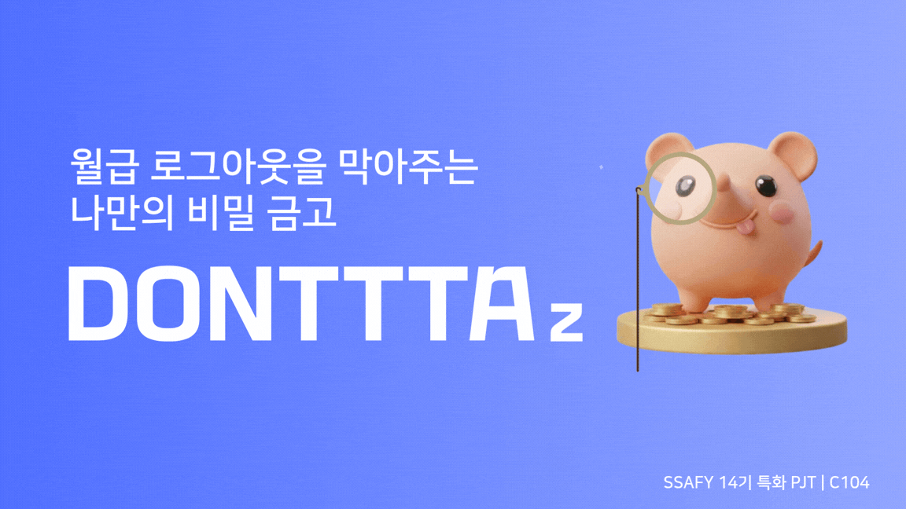
</p>

<h1 align="center">🐹 Donttaz — 돈땃쥐</h1>

<p align="center">
  <b>월급 로그아웃을 막아주는 나만의 비밀 금고</b>
</p>

<p align="center">
  
  
  
  
  
  
  
  
  
  
  
  
  
  
</p>

- **개발 기간** : 2026.02.16 ~ 2026.03.30 **(6주)**
- **플랫폼** : Mobile App (Android / iOS)
- **개발 인원** : 6명
- **기관** : 삼성 청년 SW 아카데미 14기 (핀테크 프로젝트)

---

## 🔎 목차

<div align="center">

### <a href="#intro">📌 프로젝트 소개</a>

### <a href="#background">💡 기획 의도 / 배경</a>

### <a href="#developers">🌟 팀원 구성</a>

### <a href="#features">✨ 주요 기능</a>

### <a href="#techStack">🛠️ 기술 스택</a>

### <a href="#architecture">🏗️ 시스템 아키텍처</a>

### <a href="#quickstart">🚀 빠른 시작</a>

### <a href="#directories">📂 디렉터리 구조</a>

### <a href="#troubleshooting">🔧 트러블 슈팅</a>

### <a href="#deliverables">📦 프로젝트 산출물</a>

</div>
<br>

## 📌 프로젝트 소개

<a name="intro"></a>

<p align="center">
  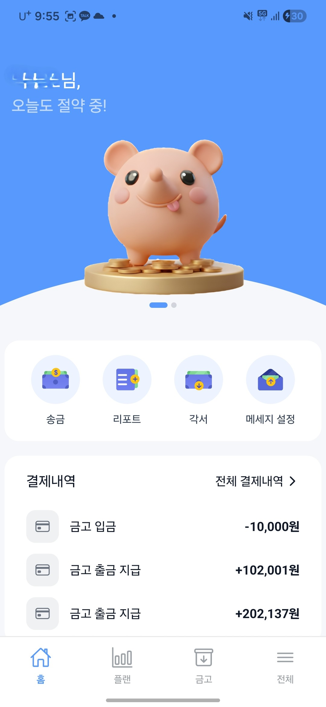
</p>

**돈땃쥐(Donttaz)**는 올바른 소비습관을 형성하고 싶은 사람들을 위한 **AI 기반 스마트 금고 핀테크 서비스**입니다.

단순히 돈을 "아끼게" 하는 것이 아니라, **쓸 돈은 쓰면서 모을 돈은 체계적으로 모을 수 있도록** 도와줍니다.
사용자는 목적별 가상 금고(위시)를 자유롭게 생성하고, 금융망 API를 통해 안전하게 자금을 입출금하며, AI가 소비 패턴을 분석하여 맞춤형 금융 조언을 제공합니다.

> 💡 **은행의 '세이프박스' + 토스 '저금통' + AI 코멘트 + AI 기반 소비 플랜**을 하나로 합친 차세대 저축 플랫폼

---

## 💡 기획 의도 / 배경

<a name="background"></a>

### "월급 로그아웃" 시대의 등장

2030 세대의 **78%** 가 "월급날 통장을 스쳐가는 돈"에 스트레스를 느낀다고 답합니다.
고정 지출, 구독 서비스, 충동 소비가 겹치면서 **월급이 들어오자마자 사라지는 '월급 로그아웃'** 현상이 일상이 되었습니다.

기존 저축 앱은 단순히 "쓰지 말라"는 메시지를 전달하지만, 이는 실질적인 행동 변화를 유도하지 못합니다.

### 돈땃쥐의 접근법

돈땃쥐는 사용자의 **소비를 억제하는 것이 아니라, 소비와 저축을 병렬로 관리**하는 구조를 제안합니다.

| 기존 저축 앱 | 돈땃쥐 |
|---|---|
| "이번 달 카페 지출이 초과했습니다" | "오사카 여행 금고에 5만원 추가하면 목표의 80%!" |
| 단일 저축 목표 | **목적별 금고** 생성 |
| 사후 알림 | **AI 선제 분석** + 실시간 푸시 |
| 수동 이체 | AI 기반 **잉여 금액 자동 봉인** |

---

## 🌟 팀원 구성

<a name="developers"></a>

<div align="center">
<table>
    <tr>
        <td width="33%" align="center">
             <br>
            <b>박형주</b> <br>팀장 (Backend & DevOps) <br>
        </td>
        <td width="33%" align="center">
             <br>
            <b>김민상</b> <br>팀원 (Backend) <br>
        </td>
        <td width="33%" align="center">
             <br>
            <b>김회인</b> <br>팀원 (Frontend & Backend) <br>
        </td>
    </tr>
    <tr>
        <td width="280px">
            <sub>
                - 인프라 및 CI/CD/CT 파이프라인 구축 <br>
                - Blue-Green 무중단 배포 시스템 설계 <br>
                - 급여 이체 로직 구현 <br>
                - 실시간 모니터링 대시보드 구축 <br>
            </sub>
        </td>
        <td width="280px">
            <sub>
                - 기본 금고 및 위시리스트 금고 API 구현 <br>
                - 금고 자동 이체 및 이자 스케줄러 구현 <br>
                - Webhook / RabbitMQ 연동 <br>
                - 모계좌 입출금 로직 설계 <br>
            </sub>
        </td>
        <td width="280px">
            <sub>
                - AI 소비 플랜/리포트 FE+BE 연동 <br>
                - 생존 번다운 차트 구현 <br>
                - PortOne 결제 인증 연동 <br>
                - 월간 소비 리포트 화면 구현 <br>
            </sub>
        </td>
    </tr>
</table>

<table>
    <tr>
        <td width="33%" align="center">
             <br>
            <b>이용호</b> <br>팀원 (Backend) <br>
        </td>
        <td width="33%" align="center">
             <br>
            <b>전연수</b> <br>팀원 (AI) <br>
        </td>
        <td width="33%" align="center">
             <br>
            <b>추지인</b> <br>팀원 (Frontend) <br>
        </td>
    </tr>
    <tr>
        <td width="280px">
            <sub>
                - FCM 푸시 알림 시스템 구현 <br>
                - 거래 내역 조회 및 동기화 <br>
                - 계좌 관련 API 구현 <br>
                - 결제 로직 구현 <br>
            </sub>
        </td>
        <td width="280px">
            <sub>
                - AI 소비 분석 서비스 설계/고도화 <br>
                - NLP 카테고리 자동 분류 모델 <br>
                - LLM 프롬프트 엔지니어링 <br>
                - 번다운 차트 예측 로직 구현 <br>
            </sub>
        </td>
        <td width="280px">
            <sub>
                - 가상금고/위시금고 FE UI 전체 <br>
                - 계좌 개설 및 이체 화면 구현 <br>
                - 웹훅 수치심 메시지 UI 연동 <br>
                - 홈/회원가입/핀 입력 UI 구현 <br>
            </sub>
        </td>
    </tr>
</table>
</div>
<br>

---

## ✨ 주요 기능

<a name="features"></a>

### 🏦 계좌 개설

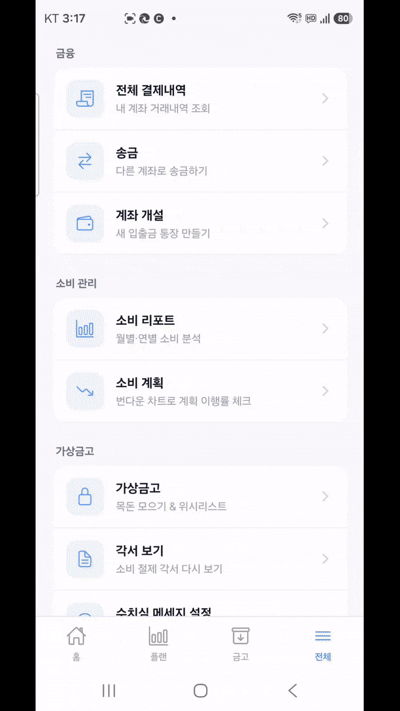 | 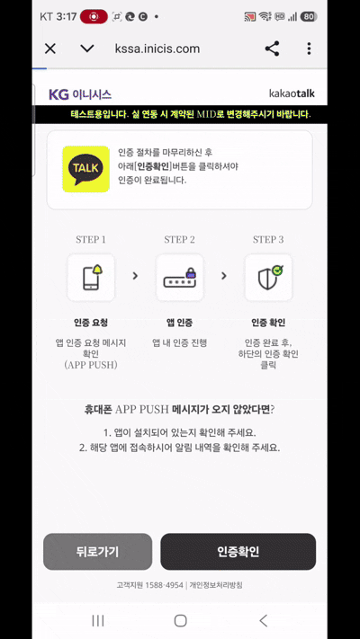 |
---|---|
개설 과정 1 | 개설 과정 2|

### 💰 위시리스트 금고
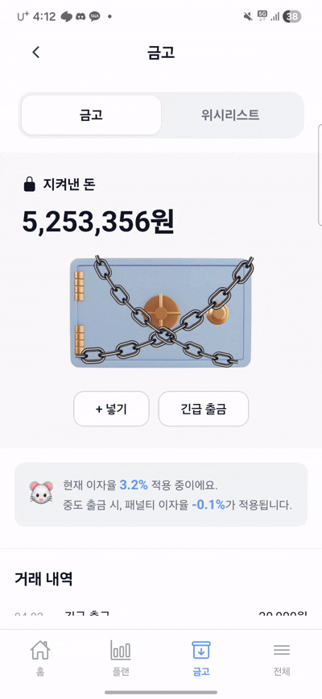 | 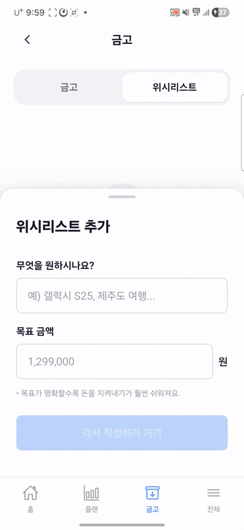 |
---|---|
위시리스트 금고 조회 | 금고 생성 | 
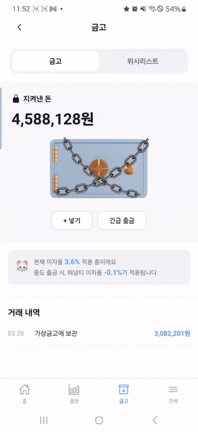 | 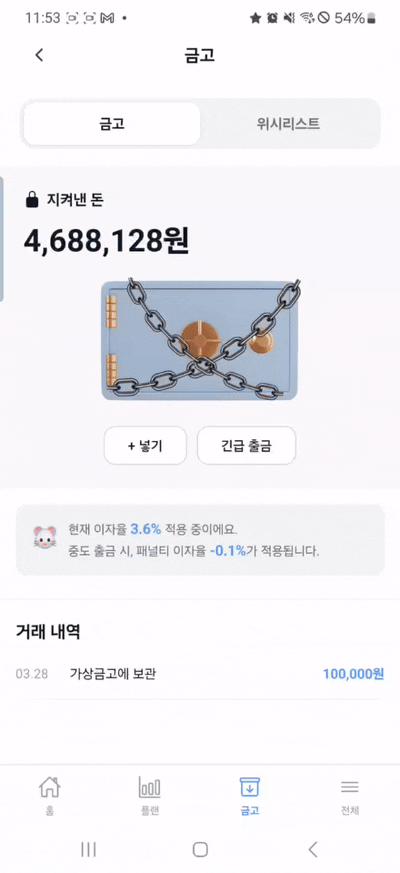 |
금고 입금 (모계좌 이체) | 금고 출금 (이자 포함) |

### 🤖 AI 분석

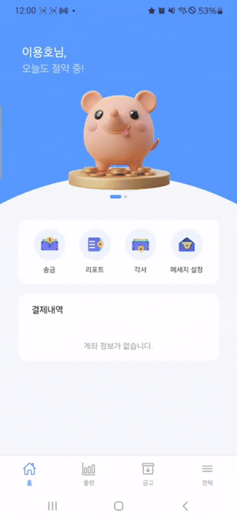 | 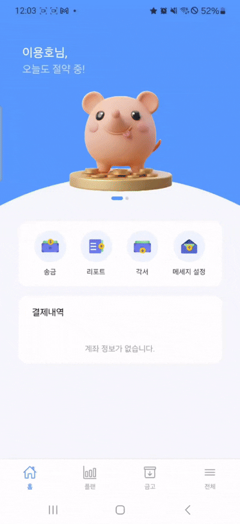 |
---|---|
AI 소비 분석 리포트 | AI 저축 플랜 추천 |

### 🔔 웹훅 알림

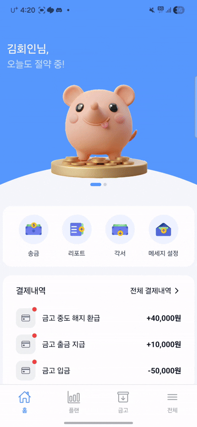 | 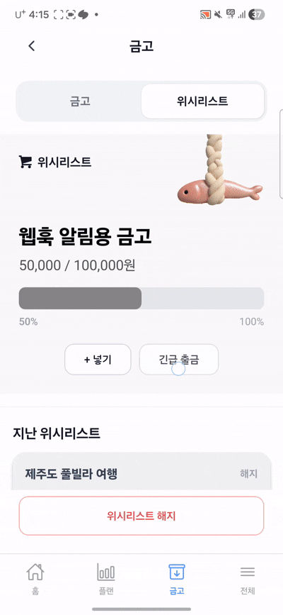 | 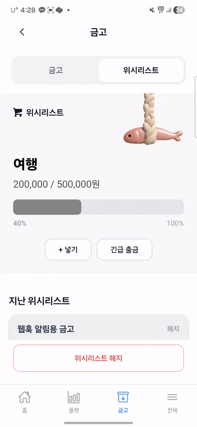 |
---|---|---|
실시간 푸시 알림 (FCM) | 위시 금고 긴급 출금 시 웹훅 전송 (Discord) | 위시 금고 긴급 해지 시 웹훅 전송 (Mattermost) |

---

## 🛠️ 기술 스택

<a name="techStack"></a>

### 📱 Frontend

<div align="center">


| **Category** | **Stack** |
| :---: | :---: |
| **Language** | TypeScript 5.9.2 |
| **Framework** | React Native 0.81.5, Expo 54.0.33 |
| **State Management** | Zustand 5.0.12 |
| **Architecture** | FSD (Feature-Sliced Design) |
| **Library** | Axios 1.13.6, Expo Router 6.0, PortOne SDK 0.6.0, React Native Reanimated 4.1 |
| **IDE** | Visual Studio Code |

</div>

### ⚙️ Backend

<div align="center">


<br>


| **Category** | **Stack** |
| :---: | :---: |
| **Language** | Java 17 |
| **Framework** | Spring Boot 3.5.11 |
| **Library** | Spring Security 6.x, Spring Data JPA 3.x, Spring AMQP 3.x, springdoc-openapi 2.8.8 |
| **Database** | MySQL 8.0 |
| **Cache** | Redis 7 (Alpine) |
| **Message Broker** | RabbitMQ 3 (Management Alpine) |
| **Push** | Firebase Admin SDK 9.4.3 (FCM) |
| **Build Tool** | Gradle 8.x |
| **IDE** | IntelliJ IDEA |

</div>

### 🤖 AI Server

<div align="center">


| **Category** | **Stack** |
| :---: | :---: |
| **Language** | Python 3.10+ |
| **Framework** | FastAPI 0.110.0 |
| **Runtime** | Uvicorn 0.27.1 |
| **Library** | OpenAI API, NeuralForecast, Sentence-Transformers, Pandas, NumPy |
| **IDE** | Visual Studio Code |

</div>

### 🛠 DevOps & Infra

<div align="center">


<br>


| **Category** | **Spec** |
| :---: | :---: |
| **Container** | Docker 27.x, Docker Compose 2.x |
| **CI/CD** | Jenkins LTS (Blue-Green 무중단 배포) |
| **Web Server** | Nginx 1.27 (Reverse Proxy, SSL) |
| **Monitoring** | Prometheus (latest), Grafana (latest) |

</div>

### 🤝 Collaboration

<div align="center">


</div>
<br>

---

## 🏗️ 시스템 아키텍처

<a name="architecture"></a>

### 🖧 System Architecture

<div align="center">


</div>

### 핵심 설계 포인트

| 설계 요소 | 구현 방식 | 효과 |
|-----------|----------|------|
| **금고(Vault) 관리** | 모계좌(Master Account) + DB 논리 분리 | 무제한 금고 생성, 20일 계좌 규제 회피 |
| **AI / API 서버 분리** | FastAPI AI 서버를 Spring Boot API 서버와 독립 컨테이너로 분리 | AI 모델 업데이트 시 API 무중단, 개별 스케일링 가능 |
| **비동기 알림** | RabbitMQ 이벤트 기반 처리 | 외부 API 레이턴시로부터 유저 응답 격리 |
| **무중단 배포** | Jenkins Blue-Green Deploy | 서비스 다운타임 제로 |
| **프론트엔드** | FSD (Feature-Sliced Design) 아키텍처 | 도메인 기반 모듈 분리, 확장성 확보 |

### 🚀 CI/CD Pipeline

<details align="left">
  <summary><strong>자세히</strong></summary>
  <div align="center">

  <table>
    <tbody align="center">
      <tr> <th>① Checkout SCM</th> </tr>
      <tr> <td>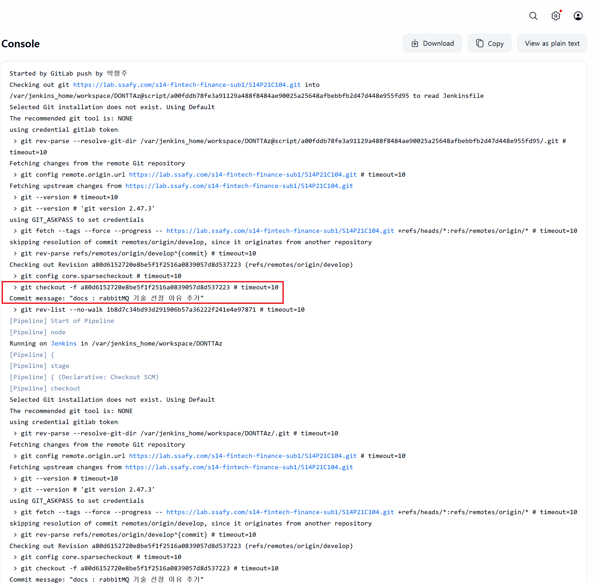</td> </tr>
    </tbody>
    <tbody align="center">
      <tr> <th>② Prepare Backend</th> </tr>
      <tr> <td>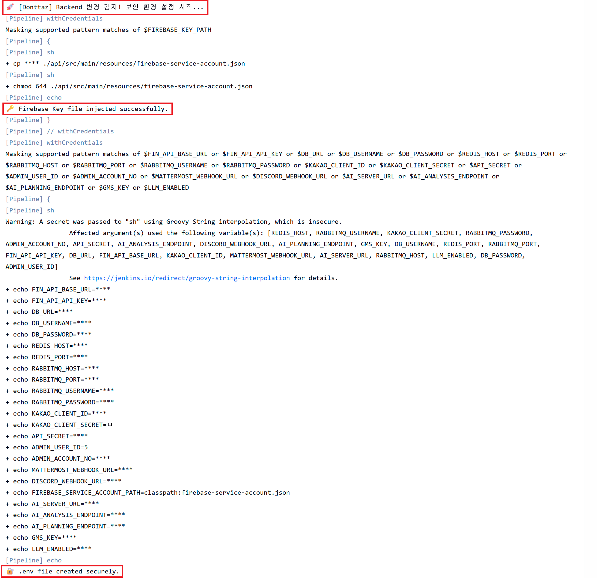</td> </tr>
    </tbody>
    <tbody align="center">
      <tr> <th>③ Test Backend (CT)</th> </tr>
      <tr> <td>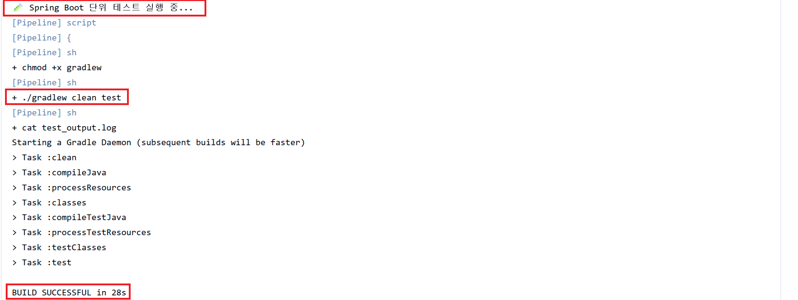</td> </tr>
    </tbody>
    <tbody align="center">
      <tr> <th>④-1 Docker Image Build</th> </tr>
      <tr> <td>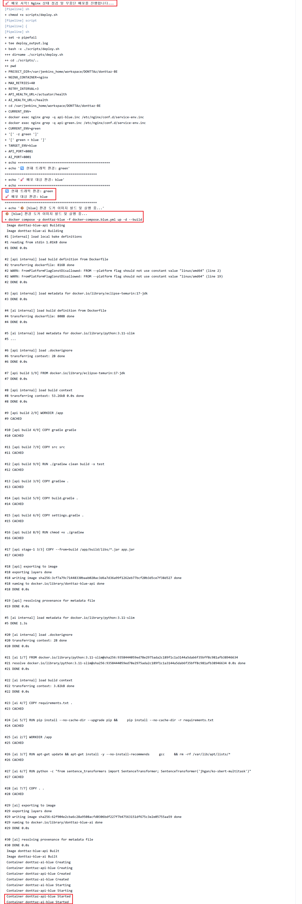</td> </tr>
    </tbody>
    <tbody align="center">
      <tr> <th>④-2 Health Check Polling</th> </tr>
      <tr> <td>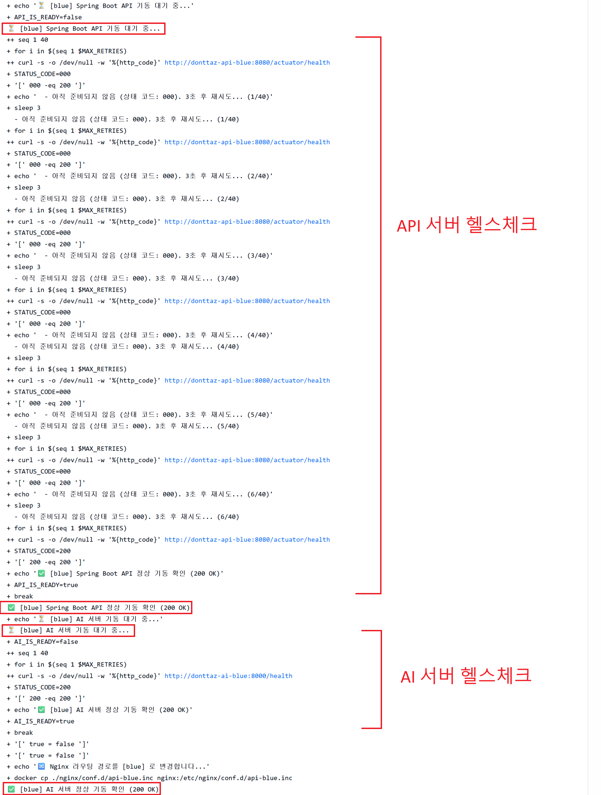</td> </tr>
    </tbody>
    <tbody align="center">
      <tr> <th>④-3 Nginx Switching & 이전 환경 종료</th> </tr>
      <tr> <td>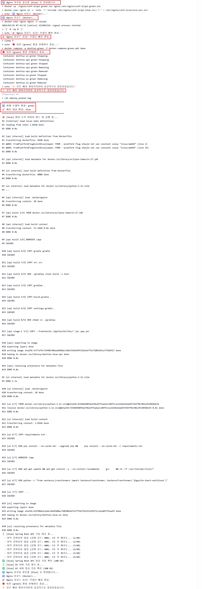</td> </tr>
    </tbody>
    <tbody align="center">
      <tr> <th>⑤ Clean up Image</th> </tr>
      <tr> <td>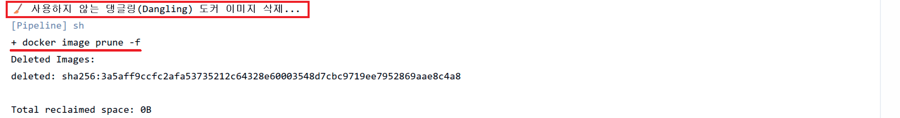</td> </tr>
    </tbody>
    <tbody align="center">
      <tr> <th>⑥ Post Actions</th> </tr>
      <tr> <td>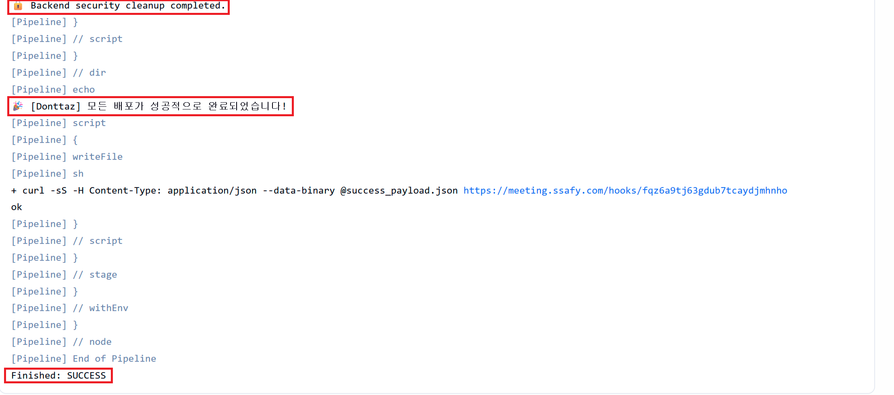</td> </tr>
    </tbody>
    <tbody align="center">
      <tr> <th>📢 Mattermost 배포 알림</th> </tr>
      <tr> <td>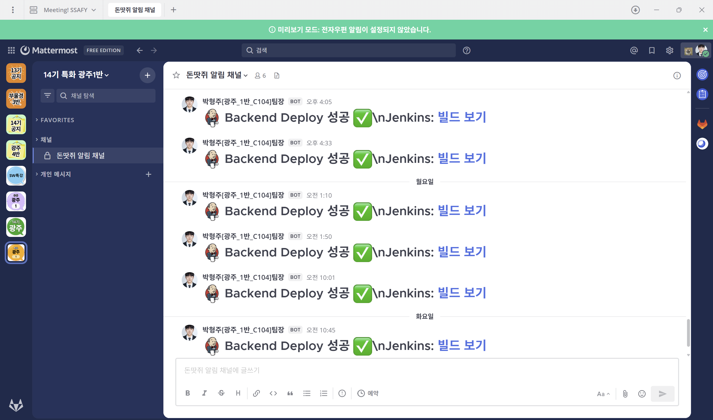</td> </tr>
    </tbody>
  </table>

  </div>
</details>

| 단계 | 스테이지명 | 설명 |
|------|-----------|------|
| **①** | **Checkout SCM** | GitLab에서 `develop` 브랜치 소스 코드 체크아웃 |
| **②** | **Prepare Backend** | Jenkins Credential에서 `firebase-service-account.json` 및 `.env` 23개 환경변수 주입 |
| **③** | **Test Backend (CT)** | `./gradlew clean test` — 6개 태스크 단위 테스트 실행 (BUILD SUCCESSFUL) |
| **④-1** | **Docker Image Build** | `docker compose up -d --build` — API(Spring Boot) + AI(FastAPI) 이미지 빌드 및 컨테이너 실행 |
| **④-2** | **Health Check Polling** | `/actuator/health`, `/health` 엔드포인트를 최대 40회(3초 간격) 폴링하여 기동 확인 |
| **④-3** | **Nginx Switching** | Nginx `service-env.inc` Blue↔Green 스위칭 → `nginx -s reload` → 이전 환경 컨테이너 종료 |
| **⑤** | **Clean up Image** | `docker image prune -f` — 댕글링 이미지 삭제 |
| **⑥** | **Post Actions** | `.env` / Firebase 키 즉시 삭제 (보안) → Mattermost 배포 성공 알림 전송 |

### 📊 Monitoring Dashboard

<details align="left">
  <summary><strong>자세히</strong></summary>
  <div align="center">

  <table>
    <tbody align="center">
      <tr> <th>🌱 Spring 애플리케이션 통계 대시보드</th> </tr>
      <tr>
        <td>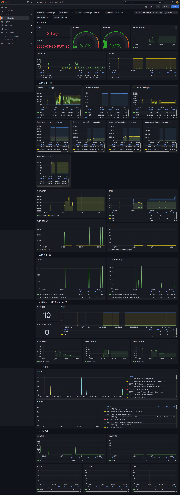</td>
      </tr>
    </tbody>
    <tbody align="center">
      <tr> <th>🚀 배포 상태 대시보드</th> </tr>
      <tr>
        <td>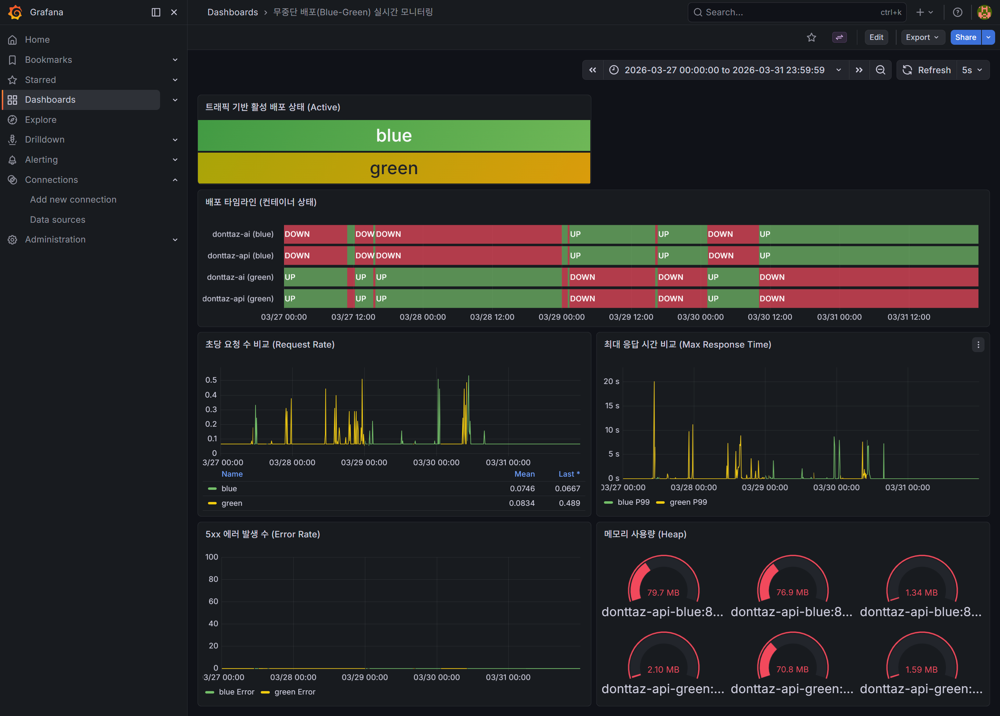</td>
      </tr>
    </tbody>
  </table>

  </div>
</details>

---

## 🚀 빠른 시작

<a name="quickstart"></a>

### 사전 요구사항

- **Java** 17+  /  **Node.js** v24.12.0 (LTS)  /  **Python** 3.10+  /  **Docker** & **Docker Compose**

### 1단계: 저장소 클론

```bash
git clone https://lab.ssafy.com/s14-fintech-finance-sub1/S14P21C104.git
cd S14P21C104
```

### 2단계: 인프라 실행

```bash
cd donttaz-infra
docker network create donttaz-net   # 최초 1회
docker compose up -d
```

### 3단계: 백엔드 서버 실행

```bash
cd donttaz-BE/api
cp ../.env.example ../.env    # 환경 변수 설정 (아래 표 참고)
./gradlew clean build
./gradlew bootRun
```
> 🌐 Swagger: `http://localhost:8080/swagger-ui/index.html`

### 4단계: AI 서버 실행

```bash
cd donttaz-BE/ai
python -m venv venv && source venv/bin/activate
pip install -r requirements.txt
uvicorn main:app --host 0.0.0.0 --port 8000 --reload
```

### 5단계: 프론트엔드 앱 실행

```bash
cd donttaz-APP/front
npm install && npm start
```
> 📱 Expo Go 앱에서 QR 코드를 스캔하여 디바이스에서 실행

### 🔧 주요 환경 변수 (.env)

| 변수명 | 설명 |
|--------|------|
| `DB_URL` | MySQL 접속 URL |
| `DB_USERNAME` / `DB_PASSWORD` | DB 사용자 인증 |
| `REDIS_HOST` / `REDIS_PORT` | Redis 접속 정보 |
| `RABBITMQ_HOST` / `RABBITMQ_PORT` | RabbitMQ 접속 정보 |
| `KAKAO_CLIENT_ID` / `KAKAO_CLIENT_SECRET` | 카카오 OAuth 키 |
| `FIN_API_BASE_URL` / `FIN_API_API_KEY` | 금융망 API |
| `AI_SERVER_URL` / `GMS_KEY` | AI 서버 및 LLM API |
| `DISCORD_WEBHOOK_URL` / `MATTERMOST_WEBHOOK_URL` | 알림 웹훅 |

> ⚠️ `.env` 파일은 `.gitignore`에 포함되어 Git에 커밋되지 않습니다.

---

## 📂 디렉터리 구조

<a name="directories"></a>

<details align="left">
  <summary>
    <strong>📦 Backend (Spring Boot API)</strong>
  </summary>

```
donttaz-BE/api/src/main/java/com/donttaz/donttazapi/
├── 📂 account/           # 계좌 관리
├── 📂 ai/               # AI 서비스 연동 (Proxy)
├── 📂 auth/             # 인증 (Kakao OAuth + JWT)
├── 📂 common/           # 공통 설정 (Security, Swagger, AOP)
├── 📂 company/          # 회사(급여) 관리
├── 📂 notification/     # FCM 푸시 알림
├── 📂 payment/          # 결제/거래 내역
├── 📂 user/             # 사용자 관리
├── 📂 vault/            # 💰 금고 (핵심 도메인)
└── 📂 webhook/          # 비동기 웹훅 (RabbitMQ)
```
</details>

<details align="left">
  <summary>
    <strong>🤖 AI Server (FastAPI)</strong>
  </summary>

```
donttaz-BE/ai/
├── main.py                  # FastAPI 진입점
├── 📂 app/api/
│   ├── report.py            # AI 소비 분석 리포트
│   ├── plan.py              # AI 저축 플랜 추천
│   ├── category.py          # 소비 카테고리 자동 분류
│   └── burndown.py          # 번다운 차트 예측
├── requirements.txt
└── Dockerfile
```
</details>

<details align="left">
  <summary>
    <strong>📱 Frontend (React Native / Expo)</strong>
  </summary>

```
donttaz-APP/front/
├── 📂 app/              # Expo Router (파일 기반 라우팅)
│   ├── _layout.tsx      # 앱 전체 레이아웃
│   ├── index.tsx        # 스플래시
│   └── (tabs)/          # 탭 네비게이션
├── 📂 pages/            # 화면 단위 컴포넌트
├── 📂 widgets/          # 재사용 위젯 (대시보드 카드 등)
├── 📂 features/         # 기능 단위 (로그인, 이체 등)
├── 📂 entities/         # 도메인 모델 (계좌, 금고, 유저)
├── 📂 shared/           # 공통 유틸, UI, API Client
└── package.json
```
</details>

<details align="left">
  <summary>
    <strong>🛠 Infrastructure (Docker Compose)</strong>
  </summary>

```
donttaz-infra/
├── docker-compose.yml    # MySQL, Redis, RabbitMQ, Prometheus, Grafana, Nginx
├── 📂 nginx/             # Nginx 전역 설정
├── 📂 prometheus/        # 메트릭 수집 설정
└── 📂 grafana/           # 대시보드 프로비저닝
```
</details>
<br>

---

## 🔧 트러블 슈팅

<a name="troubleshooting"></a>

<!-- 🖼️ [TODO] 각 팀원의 트러블 슈팅 내용을 채워주세요 -->

<details>
  <summary><strong>RabbitMQ 비동기 전환 시 메시지 유실 문제</strong></summary>

  - **문제**: 외부 웹훅(Discord/Mattermost) 알림을 RabbitMQ 비동기로 전환했을 때, Consumer 장애 시 메시지가 유실되는 현상
  - **원인**: Auto-Acknowledge 설정으로 인해 Consumer가 메시지를 받는 즉시 큐에서 삭제됨
  - **해결**: Manual Acknowledge + 지수 백오프(Exponential Backoff) 재시도 정책 적용. 3회 실패 시 DLQ(Dead Letter Queue)로 이동하여 메시지 유실 방지
</details>

<details>
  <summary><strong>모계좌 동시성 이슈 (금고 입출금)</strong></summary>

  - **문제**: 다수 사용자가 동시에 금고 입출금 요청 시, 모계좌 잔액의 Race Condition 발생
  - **원인**: DB 레벨의 트랜잭션 격리 수준만으로는 분산 환경에서 동시성 보장 불가
  - **해결**: Redis 기반 분산 락(Distributed Lock) 적용으로 모계좌 접근을 직렬화하여 데이터 정합성 확보
</details>

<details>
  <summary><strong>Blue-Green 배포 시 Health Check 타이밍 이슈</strong></summary>

  - **문제**: 새 인스턴스 기동 시 Spring Boot 초기화 완료 전 Nginx가 트래픽을 전달하여 502 에러 발생
  - **원인**: deploy.sh 스크립트에서 Health Check 간격이 너무 짧아 JVM Warm-up 이전에 트래픽 스위칭
  - **해결**: Spring Actuator `/health` 엔드포인트를 폴링하는 방식으로 변경. 최대 30초 대기 + 3회 연속 성공 조건으로 안정적 스위칭 구현
</details>

---

## 📦 프로젝트 산출물

<a name="deliverables"></a>

<!-- 🖼️ [TODO] 아래 각 항목에 스크린샷을 넣어주세요 -->

<h3><a href="https://youtu.be/-UykcFyeuZc" target="_blank">📹 Video Portfolio</a></h3>
<div align="center">

<!-- 🖼️ [TODO] 유튜브 영상 URL(-UykcFyeuZc)을 실제 영상 ID로 교체해주세요 -->
<!-- 썸네일을 사용자 지정 이미지로 바꾸려면 아래 src를 public/images/video_thumbnail.png 등으로 교체 -->
<a href="https://youtu.be/-UykcFyeuZc" target="_blank">
  
</a>

<br><br>
<sub>▲ 클릭하면 YouTube에서 영상을 볼 수 있습니다</sub>

</div>
<br>

<h3>🗄️ ERD</h3>
<details align="left">
  <summary><strong>자세히</strong></summary>
  <div align="center">

  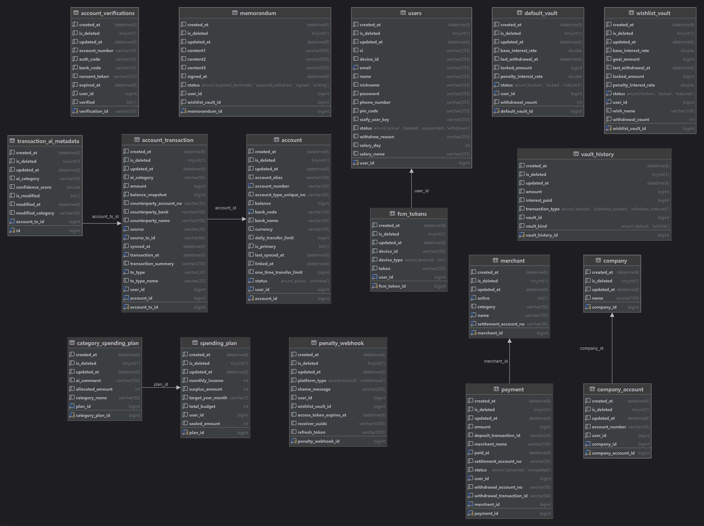
  </div>
</details>

<h3>🖼️ 화면 설계서 (Figma)</h3>
<details align="left">
  <summary><strong>자세히</strong></summary>
  <div align="center">

  <table>
    <tbody align="center">
      <tr> <th>📱 앱 메인</th> <th>🏦 계좌</th> </tr>
      <tr>
        <td width="50%">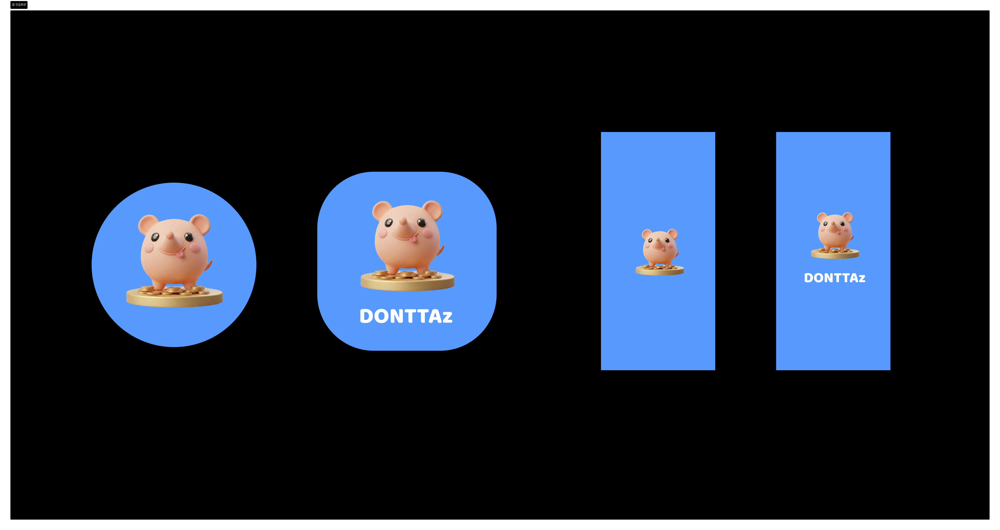</td>
        <td width="50%">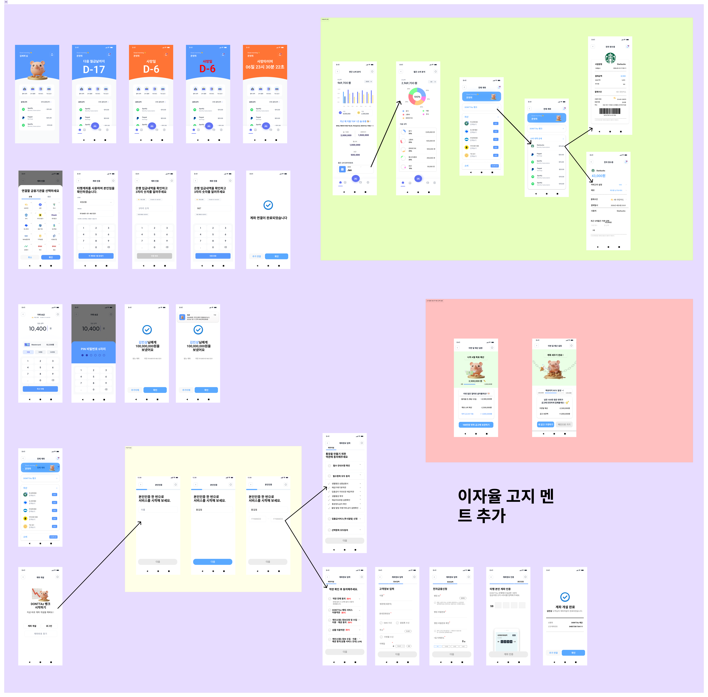</td>
      </tr>
    </tbody>
    <tbody align="center">
      <tr> <th>💰 금고 (Vault)</th> <th>👤 사용자</th> </tr>
      <tr>
        <td width="50%">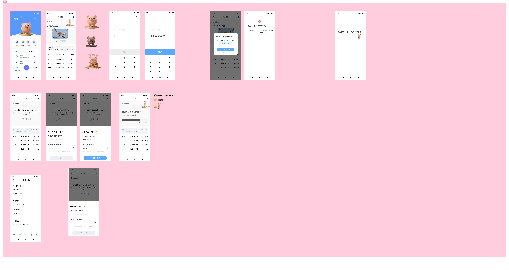</td>
        <td width="50%"></td>
      </tr>
    </tbody>
    <tbody align="center">
      <tr> <th colspan="2">📊 마이데이터</th> </tr>
      <tr>
        <td colspan="2">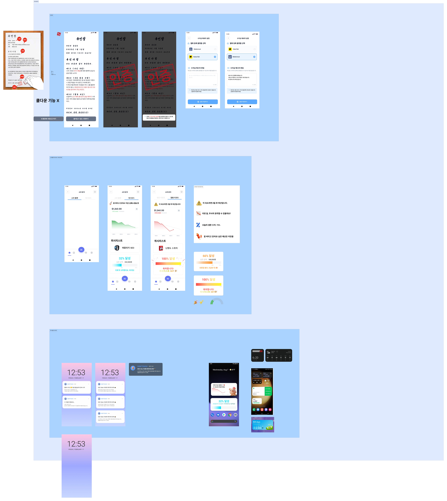</td>
      </tr>
    </tbody>
  </table>

  </div>
</details>

<h3>✅ API 연동 규격서</h3>
<details align="left">
  <summary><strong>자세히</strong></summary>
  <div align="center">

  <a href="https://docs.google.com/document/d/1ezlOeg0jZyMWbgMiTw2Jpko6lS__JQt0/edit?usp=drive_link&ouid=110954088495019042365&rtpof=true&sd=true" target="_blank">
    <!-- 🖼️ [TODO] API 규격서 첫 페이지 캡처를 public/images/api_spec_preview.png 에 넣어주세요 -->
    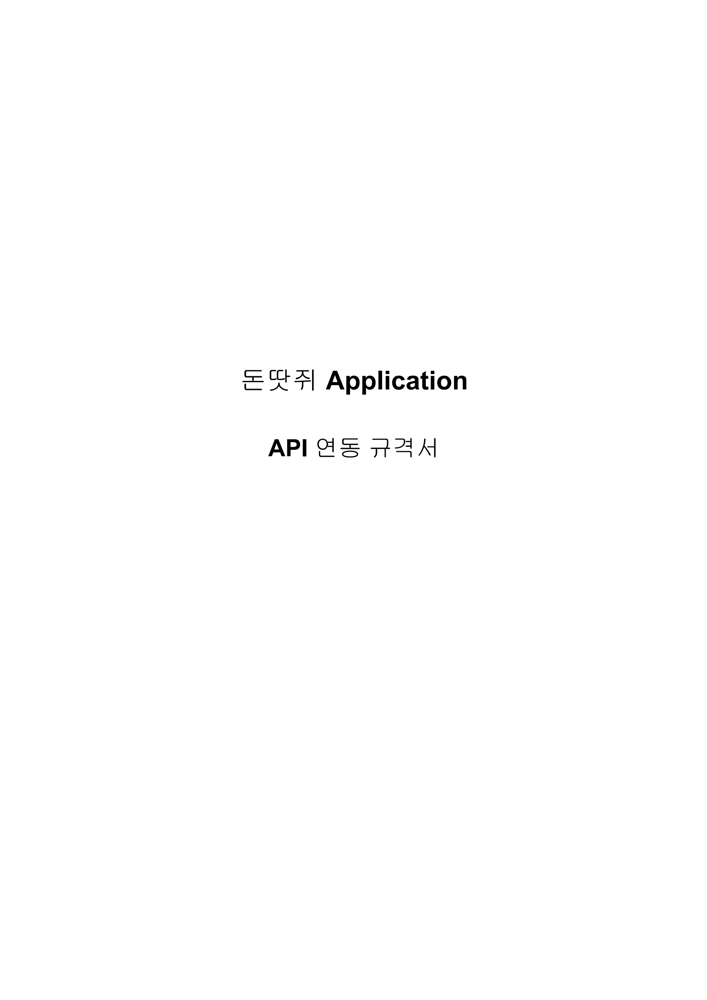
  </a>

  <br><br>
  <sub>▲ 클릭하면 Google Docs에서 전체 문서를 볼 수 있습니다</sub>

  </div>
</details>

---

## 📄 라이선스

이 프로젝트는 SSAFY(삼성 청년 SW 아카데미) 교육 과정의 일환으로 제작되었습니다.

---

<p align="center">
  Made with ❤️ by <b>Team Donttaz (C104)</b>
</p>